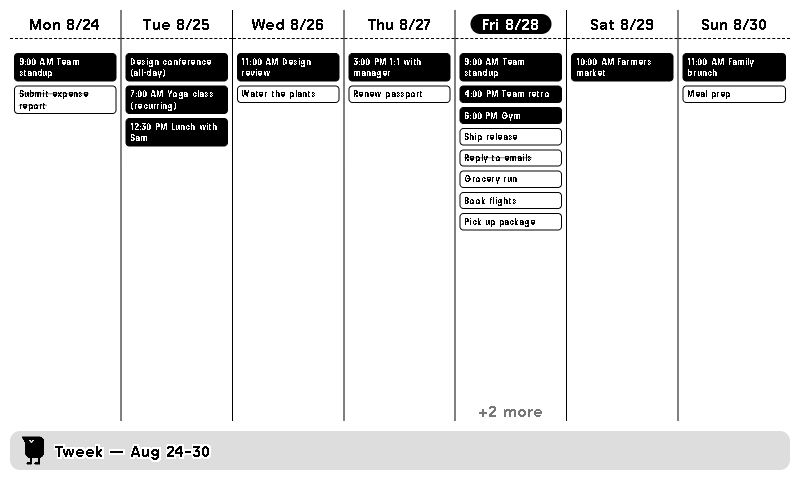

<div align="center">
  
  <h1>Tweek for TRMNL</h1>
  <p>A TRMNL e-ink plugin that shows your <a href="https://tweek.so">Tweek</a> calendar as a 7-day week grid.</p>
  
</div>

## Features

- 📅 7-column week view of your Tweek tasks and events
- 🖥️ Every layout size: **Full** and **Half Horizontal** show the week grid (Full splits into two rows in portrait), **Half Vertical** an agenda from today, and **Quadrant** just today
- 🔄 Self-contained — TRMNL fetches your tasks and a small transform shapes them into the week (refreshes every 30 min)
- ⚙️ Configurable calendar (by ID), week start day (Mon/Sun), 12h/24h time, month/day or day/month dates, an optional ISO week number, and whether completed tasks show

## How it works

The plugin uses TRMNL's **polling** strategy with a transform. On each refresh:

1. TRMNL calls the Tweek API itself (the polling URL in `tweek/src/settings.yml`), sending your API key as the `X-API-Key` header. It asks for a window of ±8 days around today, so the URL needs no timezone or week-start logic, and lets Tweek expand recurring events into per-day occurrences (`expand=occurrences`)
2. `tweek/src/transform.js` picks your current week out of that window (honouring your timezone and week start day) and turns Tweek errors into a short message on screen
3. The Liquid templates render the result. Each layout (`full`, `half_horizontal`, `half_vertical`, `quadrant`) is a few lines; the shared pieces (task card, day header, week grid, title bar) live in `tweek/src/shared.liquid`, which TRMNL prepends to every layout

Because TRMNL makes the request before the transform runs, the API call doesn't count against the transform's 5-second limit.

## Setup

1. **Get your Tweek API key** — in the Tweek app, go to **Profile → API Settings** and generate a key (starts with `twk_`). It does not expire.
2. **Get your Calendar ID** — in the Tweek app, open **Calendar settings** and copy the **Calendar ID** shown at the bottom (tap the copy icon).
   Power users can instead list calendars via the API and copy the `id`:
   ```bash
   curl -H "X-API-Key: twk_..." https://tweek.so/api/v1/calendars
   ```
3. **Add the plugin in TRMNL** and fill in the fields:
   - **API Key** — the value from step 1
   - **Calendar ID** — the `id` from step 2
   - **Week Start Day** — Monday or Sunday
   - **Time Format** — 12h or 24h
   - **Date Format** — month/day (8/24, the default) or day/month (24/8), for the day headers and the week label
   - **Show Completed Tasks** — on by default (crossed out); turn off to hide them
   - **Show Week Number** — off by default; adds the ISO week number to the title bar, e.g. `Oct 12–18 — Week 42`. For Sunday-start weeks it's the ISO week of that week's Monday

## Development

```bash
npm install
npm test               # run the unit tests (vitest)
trmnlp serve -d tweek  # local preview with mock data
trmnlp push -d tweek   # upload to the TRMNL server
```

Pure date/task utilities live in `src/utils.js` and are mirrored into `tweek/src/transform.js` (which must be self-contained for TRMNL) — keep the two in sync.

## Notes

- Your Tweek API key is stored as a password field in the plugin settings and sent only to the Tweek API.
- Unofficial personal project; not affiliated with Tweek or TRMNL.

## License

[MIT](LICENSE)
